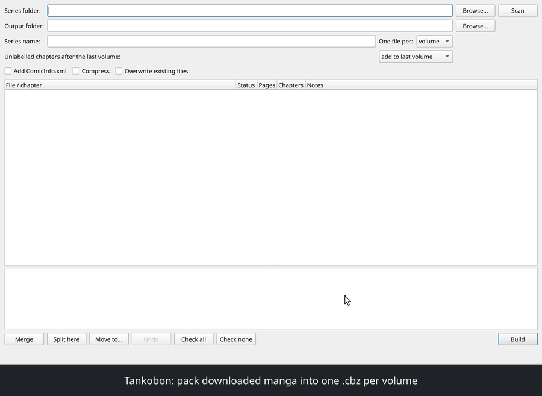
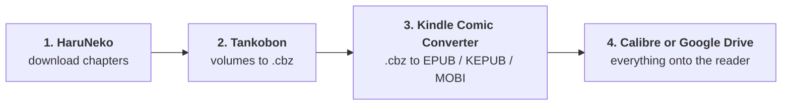
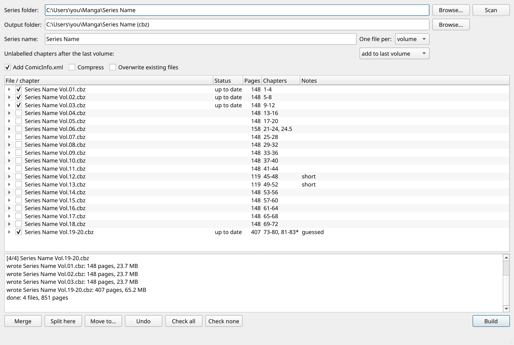
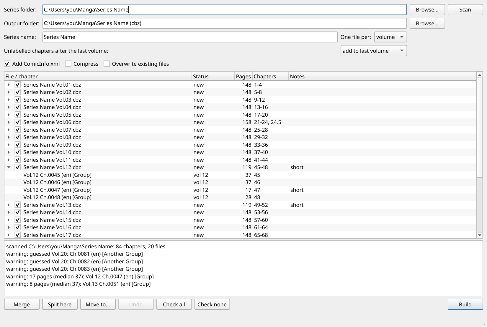

<div align="center">

# manga-to-ereader

**Download manga for free, pack it into one `.cbz` per volume, convert it for your e-reader, and move the whole series over in one go.**

[](https://github.com/YatoVoid/manga-to-ereader/actions/workflows/ci.yml)
[](https://github.com/YatoVoid/manga-to-ereader/releases/latest)
[](https://www.python.org/)
[](LICENSE)

[**Download Tankobon**](https://github.com/YatoVoid/manga-to-ereader/releases/latest) · [The four steps](#the-four-steps) · [Install](#install-tankobon) · [Using Tankobon](#using-tankobon) · [Command line](#command-line)



<sub>26-second demo. <a href="docs/demo.mp4">Full-resolution MP4</a></sub>

</div>

---

Reading manga on an e-reader takes four free tools in a row. This repo walks through all of them and provides the missing piece in the middle: **Tankobon**, which packs the downloaded chapter folders into one `.cbz` per volume, pages in the right order, ready for Kindle Comic Converter.



| Step | Tool | Made by | What you get |
|---|---|---|---|
| 1 | [HaruNeko](https://github.com/manga-download/haruneko) | the HakuNeko team | One folder of images per chapter |
| 2 | **Tankobon** | this repo | One `.cbz` per volume, every chapter in its volume, pages in order |
| 3 | [Kindle Comic Converter](https://github.com/ciromattia/kcc) | ciromattia and contributors | Files sized and formatted for your exact device |
| 4 | [Calibre](https://calibre-ebook.com/) or [Google Drive](https://drive.google.com) | Kovid Goyal / Google | The whole series on your e-reader |

Why the middle step matters: KCC converts `.cbz` files, but HaruNeko gives you loose folders of images, one per chapter. A `.cbz` is just a zip archive of images with a different ending. Zipping each volume by hand means finding which chapters belong to it, getting the page order right (`10.jpg` must come after `9.jpg`, not after `1.jpg`), and working out where chapters with no volume number belong. Tankobon does all of that for the whole series in one click.

## The four steps

### 1. Download the manga with HaruNeko

[HaruNeko](https://github.com/manga-download/haruneko) is a free desktop app that searches and downloads manga from hundreds of websites. It is the successor to HakuNeko and a separate project from this one.

1. Download the build for your system from the [HaruNeko releases page](https://github.com/manga-download/haruneko/releases) and install it.
2. Pick a website from the list, search for the series and open it.
3. Select the chapters you want (Shift+click selects a range) and download them.

You end up with a folder named after the series, holding one folder per chapter:

```
Series Name/
├── Vol.01 Ch.0001 (en) [Group]/      1.jpg  2.png  3.jpg ...
├── Vol.01 Ch.0002 (en) [Group]/
├── ...
└── Ch.0093 (en) [Another Group]/
```

### 2. Pack each volume into a .cbz with Tankobon

1. Install Tankobon for your system ([Windows, macOS and Linux instructions](#install-tankobon)) and open it.
2. Click **Browse** and choose the series folder from step 1.
3. Check the plan. Every volume is listed with its chapters and page count. Chapters that look incomplete are marked **short**, and chapters whose volume was worked out for you are marked **guessed**.
4. Click **Build**.

For each volume, Tankobon collects its chapters in order, puts every page in reading order, zips them and saves the result as a `.cbz`. Chapters the website left without a volume number are placed in the volume they belong to by chapter number, so nothing is left out.

The `.cbz` files are written to a new folder next to the series folder, named `<series> (cbz)`. Your downloaded chapters are not changed.

<div align="center">

</div>

Prefer the terminal? See [Command line](#command-line).

### 3. Convert for your e-reader with Kindle Comic Converter

[Kindle Comic Converter](https://github.com/ciromattia/kcc) (KCC) is a free converter built for comics on e-ink. Despite the name it works for Kobo, PocketBook, Boox and others too. It trims margins, sizes every page for your screen and writes the format your reader prefers. It is a separate project.

1. Download KCC from its [releases page](https://github.com/ciromattia/kcc/releases).
2. Drag **all** the `.cbz` files from step 2 into the KCC window at once. It converts them in a batch.
3. Pick your exact e-reader model from the device list.
4. Pick the output format:

   | Your reader | Format in KCC |
   |---|---|
   | Kobo | **KEPUB** |
   | Kindle | **MOBI/AZW3** (KCC needs KindleGen for this; its README explains where to get it) |
   | PocketBook, Boox, Tolino, others | **EPUB** |

5. Tick **Manga mode** so pages turn right to left, then click **Convert**.

### 4. Move everything onto the e-reader

Use whichever suits your reader. Both handle a whole series at once.

#### With Calibre (USB, works with every reader)

[Calibre](https://calibre-ebook.com/) is a free e-book library manager and a separate project.

1. Install it from [calibre-ebook.com/download](https://calibre-ebook.com/download).
2. Drag the converted files from step 3 into Calibre. You can drop the whole folder.
3. Plug the e-reader in with a USB cable. Calibre detects it.
4. Select all the volumes (Ctrl+A), right-click and choose **Send to device**.
5. Eject the reader from Calibre before unplugging it.

#### With Google Drive (no cable)

1. Open [Google Drive](https://drive.google.com) and drag the folder of converted files in.
2. On a reader with Google Drive built in (several recent Kobo models), sign in from the reader and download the folder.
3. On an Android-based reader (Boox and similar), open the Google Drive app and download the files.

Kindles have no Google Drive support, so use Calibre for those.

---

## Install Tankobon

Every download is on the [latest release](https://github.com/YatoVoid/manga-to-ereader/releases/latest) page, under **Assets**. Find your system below.

| Your system | What to get |
|---|---|
| [Windows 10 / 11](#windows) | `Tankobon.exe` |
| [macOS, Apple Silicon (M1 and newer)](#macos) | `Tankobon-macos-arm64.dmg` |
| [macOS, Intel](#from-source-any-system) | Install from source |
| [Arch, Manjaro, EndeavourOS, CachyOS, Garuda](#arch-linux-and-derivatives) | `yay -S tankobon` |
| [Ubuntu, Debian, Linux Mint, Pop!_OS, Zorin, elementary](#ubuntu-debian-and-derivatives) | `tankobon_<version>_amd64.deb` |
| [Fedora, openSUSE, and any other Linux](#fedora-opensuse-and-any-other-linux) | `Tankobon-x86_64.AppImage` |
| [Linux on ARM, Raspberry Pi, anything else](#from-source-any-system) | Install from source |

Every option includes both the desktop app and the `tankobon` command line.

### Windows

1. Download **`Tankobon.exe`** from the [latest release](https://github.com/YatoVoid/manga-to-ereader/releases/latest).
2. Move it somewhere it can stay, such as your Desktop or Documents folder.
3. Double-click it.
4. The first time, Windows shows **"Windows protected your PC"** because the app isn't signed by Microsoft. Click **More info**, then **Run anyway**. It won't ask again.

**Command line:** download `tankobon-cli.exe` as well, open PowerShell in the folder you saved it to, and run:

```powershell
.\tankobon-cli.exe build "C:\Users\you\Manga\Series Name"
```

**Uninstall:** delete the `.exe` files.

### macOS

For Macs with Apple Silicon (M1, M2, M3, M4 and newer). To check, open the Apple menu and choose **About This Mac**. If it says **Intel**, use [From source](#from-source-any-system) instead.

1. Download **`Tankobon-macos-arm64.dmg`** from the [latest release](https://github.com/YatoVoid/manga-to-ereader/releases/latest).
2. Open it and drag **Tankobon** into **Applications**.
3. The first time, open **Applications**, right-click **Tankobon**, choose **Open**, then click **Open** again. The app isn't signed by Apple, so a normal double-click is blocked the first time only.
4. If macOS says the app **is damaged and can't be opened**, open **Terminal** and run:

   ```
   xattr -dr com.apple.quarantine /Applications/Tankobon.app
   ```

**Command line:** download `tankobon-cli-macos-arm64.tar.gz`, then in Terminal:

```
cd ~/Downloads
tar -xzf tankobon-cli-macos-arm64.tar.gz
xattr -d com.apple.quarantine tankobon
sudo mkdir -p /usr/local/bin
sudo mv tankobon /usr/local/bin/
tankobon --help
```

**Uninstall:** drag Tankobon from Applications to the Trash.

### Arch Linux and derivatives

Tankobon is in the AUR as [`tankobon`](https://aur.archlinux.org/packages/tankobon). It works on Arch, Manjaro, EndeavourOS, CachyOS, Garuda and other Arch-based systems.

With an AUR helper:

```
yay -S tankobon        # or: paru -S tankobon
```

Without one:

```
sudo pacman -S --needed git base-devel
git clone https://aur.archlinux.org/tankobon.git
cd tankobon
makepkg -si
```

Open **Tankobon** from your app menu, or run `tankobon-gui`. The command line is `tankobon`.

**Update:** `yay -Syu`. **Uninstall:** `sudo pacman -R tankobon`.

### Ubuntu, Debian and derivatives

Works on Ubuntu 22.04 and newer, Debian 12 and newer, and systems based on them: Linux Mint, Pop!_OS, Zorin OS, elementary OS, KDE neon.

1. Download **`tankobon_<version>_amd64.deb`** from the [latest release](https://github.com/YatoVoid/manga-to-ereader/releases/latest).
2. Install it. Either double-click the file and click **Install**, or open a terminal and run:

   ```
   cd ~/Downloads
   sudo apt install ./tankobon_*_amd64.deb
   ```

3. Open **Tankobon** from your app menu, or run `tankobon-gui`. The command line is `tankobon`.

**Update:** download the new `.deb` and install it the same way. **Uninstall:** `sudo apt remove tankobon`.

### Fedora, openSUSE and any other Linux

The AppImage runs on almost any 64-bit Linux without installing anything.

1. Download **`Tankobon-x86_64.AppImage`** from the [latest release](https://github.com/YatoVoid/manga-to-ereader/releases/latest).
2. Make it runnable. Right-click it, open **Properties**, and turn on **Allow executing as a program**. Or in a terminal:

   ```
   chmod +x ~/Downloads/Tankobon-x86_64.AppImage
   ```

3. Double-click it, or run `~/Downloads/Tankobon-x86_64.AppImage`.

If it doesn't start, your system is missing FUSE 2, which AppImages need:

| System | Command |
|---|---|
| Fedora | `sudo dnf install fuse-libs` |
| openSUSE | `sudo zypper install libfuse2` |
| Ubuntu 24.04 and newer | `sudo apt install libfuse2t64` |
| Arch | `sudo pacman -S fuse2` |

**Command line:** the same file runs it. Put a subcommand after it:

```
~/Downloads/Tankobon-x86_64.AppImage build ~/Manga/"Series Name"
```

**Without FUSE or an AppImage:** download `tankobon-linux-x86_64.tar.gz` instead, then:

```
tar -xzf tankobon-linux-x86_64.tar.gz
./tankobon-linux-x86_64/tankobon-gui      # desktop app
./tankobon-linux-x86_64/tankobon --help   # command line
```

**Uninstall:** delete the file or folder.

### From source (any system)

For Intel Macs, Linux on ARM (Raspberry Pi and others), or anything not listed above. Needs Python 3.10 or newer.

1. Install pipx:

   | System | Command |
   |---|---|
   | macOS | `brew install pipx` (needs [Homebrew](https://brew.sh)) |
   | Windows | `py -m pip install --user pipx` |
   | Ubuntu, Debian | `sudo apt install pipx` |
   | Fedora | `sudo dnf install pipx` |
   | Arch | `sudo pacman -S python-pipx` |

2. Run `pipx ensurepath`, then close and reopen the terminal.
3. Install Tankobon:

   ```
   pipx install "manga-to-ereader[gui] @ git+https://github.com/YatoVoid/manga-to-ereader"
   ```

4. Run `tankobon-gui` for the desktop app or `tankobon --help` for the command line.

Leave out `[gui]` for the command line only. **Update:** `pipx upgrade manga-to-ereader`. **Uninstall:** `pipx uninstall manga-to-ereader`.

### Check that it works

Run `tankobon --version` (on Windows, `.\tankobon-cli.exe --version`). It prints the installed version, for example `tankobon 0.1.1`.

## Using Tankobon

### The desktop app



- **Untick** volumes you don't want to build.
- **Expand** a volume to see each chapter, its page count and any warnings.
- **Merge** joins the selected volumes into one file, for example `Vol.19-20.cbz`.
- **Split here** starts a new file at the selected chapter.
- **Move to** puts the selected chapters into a different volume.
- **Undo** steps back.
- **Add ComicInfo.xml** stores the series, volume, page count and scan group inside each file. Komga and Kavita read it.

Run it again after new chapters come out and only the volumes that changed are rebuilt. The rest show as **up to date**.

### Command line

```
tankobon build <series folder> [options]
```

Preview first, then build:

```
tankobon build "Series Name" --series "Series Name" --dry-run
tankobon build "Series Name" --series "Series Name"
```

| Option | What it does |
|---|---|
| `--out DIR` | Where to write the files. Default: `<folder> (cbz)` next to the series folder. |
| `--series NAME` | Name used in the file names. Default: the folder name. |
| `--dry-run` | Show exactly what would be written, without writing anything. |
| `--per volume\|chapter\|all` | One file per volume (default), per chapter, or one for the whole series. |
| `--trailing last\|new\|skip` | Where unlabelled chapters after the last volume go. See below. |
| `--assign 93-95=21` | Put chapters 93 to 95 in volume 21. Single chapters work too: `67.5=17`. |
| `--merge 1-3` | Merge volumes 1 to 3 into `Vol.01-03.cbz`. |
| `--split 48` | Start a new file at chapter 48. |
| `--only 1-5,8` | Build only these volumes. |
| `--comicinfo` | Add `ComicInfo.xml` to each file. |
| `--overwrite` | Replace `.cbz` files already in the output folder. |
| `--strict` | Stop without writing if there are any warnings. |
| `--pattern REGEX` | Your own chapter-name pattern, with a named group `ch` and optionally `vol`. |

`--assign`, `--merge` and `--split` can be repeated. Exit codes: `0` done, `1` a file failed, `2` bad input, `3` no chapters found, `4` warnings with `--strict`.

#### Interactive mode

Review and edit the plan in the terminal before anything is written. Works over SSH.

```
$ tankobon interactive "Series Name"
  1 [x] write      Series Name Vol.01.cbz  148p  Ch.1-4
  ...
 20 [x] write      Series Name Vol.20.cbz  259p  Ch.77-80, 81-83*
> m 19-20
```

| Command | Action |
|---|---|
| `s 12` | Show the chapters in file 12 |
| `t 1-5` | Include or exclude files 1 to 5 |
| `m 19-20` | Merge files 19 and 20 |
| `p 48` | Start a new file at chapter 48 |
| `v 93 20` | Move chapter 93 into file 20 |
| `u` | Undo |
| `b` | Build (asks first) |
| `q` | Quit without writing |

### How Tankobon reads your folders

**Folder names.** Tankobon recognizes the names HaruNeko, HakuNeko and Mihon/Tachiyomi use, and a few common others:

```
Vol.01 Ch.0001 (en) [Group]        Vol.17 Ch.0067.5 - Side Story (en) [Group]
Ch.0093 (en) [Group]               Vol.TBD Ch.93
[Group] Vol.02 Ch.0010             Series Name Chapter 5
Volume 1 Chapter 3                 v01 c003
093                                12.5 - Extra
```

Chapters can also be `.cbz` or `.zip` files, or sit inside volume folders like `Volume 3/Chapter 12/`. Pages are put in the order a person would expect (1, 2, 10, not 1, 10, 2) and bonus chapters land in the right place (26, 26.5, 27).

**Chapters with no volume.** Sites often leave the newest chapters without a volume number. Tankobon does not drop them. Each one joins the volume of the closest labelled chapter before it, and is marked **guessed** so you can check it.

Chapters after the last volume usually aren't in a printed volume yet. You choose where they go:

| Setting | Result |
|---|---|
| Add to last volume | The default |
| New volume | A new volume after the last one |
| Leave out | Not built |

To fix a guess for good, add a `volumes.toml` file to the series folder. Tankobon picks it up automatically:

```toml
93-95 = 21
67.5 = 17
```

**Warnings.**

| Warning | Meaning |
|---|---|
| Short | Far fewer pages than a typical chapter. Usually a broken download, so re-download it. Bonus chapters like 26.5 are not checked. |
| Empty | The chapter folder has no images. |
| Gap | Chapter numbers are missing from the sequence. |
| Duplicate | The same chapter was downloaded twice, often from two groups. |

**The files it writes.**

- Named `<Series> Vol.01.cbz`, with three-digit volumes for series past 99.
- Pages are stored flat and numbered (`0001_Ch0001_1.jpg`), so every reader shows them in order.
- Each file is checked after writing before it replaces anything. If one volume fails, nothing half-written is left behind and the other volumes still build.

**OneDrive.** A full series can be several GB. If your manga folder lives in OneDrive, choose an output folder outside it, or OneDrive will upload every file. Tankobon warns you before writing into one.

## Development

```
git clone https://github.com/YatoVoid/manga-to-ereader
cd manga-to-ereader
python -m venv .venv
.venv/bin/pip install -e ".[gui]" pytest
.venv/bin/pytest
```

The core library is in `src/tankobon/`. The command line, interactive mode and desktop app are thin layers on top of it. Pushing a tag like `v0.1.0` builds both Windows `.exe` files on GitHub Actions and attaches them to a release.

## A note on downloading

Tankobon only reorganizes files that are already on your computer. HaruNeko downloads from third-party websites, and whether a given site is allowed to host a series depends on the site and on where you live. If a series has an official English release, buying it is what keeps it being translated.

## License

Tankobon is [MIT licensed](LICENSE). HaruNeko, Kindle Comic Converter and Calibre are separate projects with their own licenses.
