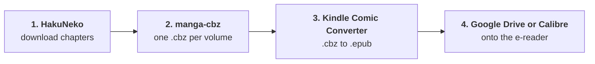

<div align="center">

# manga-cbz

**Turn a folder of downloaded manga chapters into one clean `.cbz` per volume.**

[](https://github.com/YatoVoid/manga-cbz/actions/workflows/ci.yml)
[](https://github.com/YatoVoid/manga-cbz/releases)
[](https://www.python.org/)
[](LICENSE)

[Download](https://github.com/YatoVoid/manga-cbz/releases) · [The full workflow](#from-download-to-e-reader) · [Command line](#command-line) · [Desktop app](#desktop-app)

</div>

---

Manga downloaders save one folder per **chapter**. E-readers are much nicer with one file per **volume**. manga-cbz groups the chapter folders into volumes, fills in the chapters that have no volume label, warns you about missing or short chapters, and writes one `.cbz` per volume. Your original folders are never touched.

```
Monster Musume no Iru Nichijou/                Monster Musume no Iru Nichijou (cbz)/
├── Vol.01 Ch.0001 (en) [Group]/               ├── Monster Musume Vol.01.cbz
├── Vol.01 Ch.0002 (en) [Group]/      ──►      ├── Monster Musume Vol.02.cbz
├── ...                                        ├── ...
└── Ch.0093 (en) [Other Group]/                └── Monster Musume Vol.20.cbz
```

## From download to e-reader



### 1. Download the manga with HakuNeko

[HakuNeko](https://github.com/manga-download/hakuneko) is a free desktop app for downloading manga from hundreds of sites. It is a separate project, not part of this repo.

1. Install HakuNeko from its [releases page](https://github.com/manga-download/hakuneko/releases).
2. Pick a source site, search for the series and select the chapters you want.
3. Download them. Leave the output format as plain image folders (the default). You end up with one folder per chapter inside a folder named after the series.

### 2. Bundle the chapters into volumes with manga-cbz

This is the part this repo does. Use whichever you prefer:

- **Windows app:** download `manga-cbz-gui.exe` from [Releases](https://github.com/YatoVoid/manga-cbz/releases), open it, choose the series folder, tick the volumes you want and press **Build**.
- **Command line:**

  ```
  manga-cbz build "Monster Musume no Iru Nichijou" --series "Monster Musume"
  ```

The `.cbz` files land in a new folder next to the series folder, named `<series> (cbz)`.

### 3. Convert the .cbz files to EPUB with Kindle Comic Converter

[Kindle Comic Converter](https://github.com/ciromattia/kcc) (KCC) is a free app that optimizes comics for e-ink screens: it crops margins, resizes pages to fit your device and converts the files. It is a separate project.

1. Install KCC from its [releases page](https://github.com/ciromattia/kcc/releases).
2. Drag the `.cbz` files from step 2 into the window.
3. Choose your e-reader model from the device list and set the output format to **EPUB** (or **KEPUB** if you have a Kobo).
4. Turn on **Manga mode** so pages read right to left, then press **Convert**.

### 4. Send the EPUB to your e-reader

Pick whichever fits your device.

**Google Drive.** Upload the EPUB files to [Google Drive](https://drive.google.com). On readers with Google Drive built in, open Drive from the reader and download them. On Android-based readers, use the Drive app.

**Calibre.** [Calibre](https://calibre-ebook.com/) is a free e-book manager, also a separate project.

1. Install Calibre from [calibre-ebook.com/download](https://calibre-ebook.com/download).
2. Drag the EPUB files into the library.
3. Plug the e-reader in over USB, select the books and click **Send to device**.

---

## Install

**Windows:** grab `manga-cbz-gui.exe` (desktop app) and `manga-cbz.exe` (command line) from [Releases](https://github.com/YatoVoid/manga-cbz/releases). Nothing else to install. The exe is not code-signed, so Windows SmartScreen asks for confirmation the first time.

**From source** (Windows or Linux, Python 3.10+):

```
pip install git+https://github.com/YatoVoid/manga-cbz
pip install "manga-cbz[gui] @ git+https://github.com/YatoVoid/manga-cbz"   # with the desktop app
```

## Desktop app

<!-- Screenshot: save one as docs/screenshot.png and uncomment the line below. -->
<!--  -->

1. **Browse** to the series folder. The table fills with the planned volumes and their chapters.
2. Untick volumes you don't want. Expand a volume to see its chapters, page counts and warnings.
3. Fix anything that looks wrong:
   - **Merge** joins the selected volumes into one file.
   - **Split here** starts a new file at the selected chapter.
   - **Move to** puts the selected chapters into another volume.
   - **Undo** reverts the last change.
4. Press **Build**. Progress and results show in the log at the bottom.

## Command line

```
manga-cbz build <series folder> [options]
```

Preview first, then build:

```
manga-cbz build "Monster Musume no Iru Nichijou" --series "Monster Musume" --dry-run
manga-cbz build "Monster Musume no Iru Nichijou" --series "Monster Musume"
```

| Option | What it does |
|---|---|
| `--out DIR` | Where to write the files. Default: `<folder> (cbz)` next to the series folder. |
| `--series NAME` | Name used in the file names. Default: the folder name. |
| `--dry-run` | Show exactly what would be written, without writing anything. |
| `--per volume\|chapter\|all` | One file per volume (default), per chapter, or one file for the whole series. |
| `--trailing last\|new\|skip` | What to do with unlabelled chapters after the last volume. See below. |
| `--assign 93-95=21` | Put chapters 93 to 95 in volume 21. Works with single chapters too: `67.5=17`. |
| `--merge 1-3` | Merge volumes 1 to 3 into `Vol.01-03.cbz`. |
| `--split 48` | Start a new file at chapter 48. |
| `--only 1-5,8` | Build only these volumes. |
| `--comicinfo` | Add a `ComicInfo.xml` with series, volume, page count, language and scan group. Komga and Kavita read it. |
| `--overwrite` | Replace existing `.cbz` files. |
| `--strict` | Stop without writing if there are any warnings. |
| `--pattern REGEX` | Your own chapter-name pattern, with a named group `ch` and optionally `vol`. |

`--assign`, `--merge` and `--split` can be repeated. Run `manga-cbz build --help` for the rest.

### Interactive mode

Review and edit the plan in the terminal before anything is written. Works over SSH.

```
manga-cbz interactive "Monster Musume no Iru Nichijou"
```

```
  1 [x] write      Monster Musume Vol.01.cbz  132p  Ch.1-4
  ...
 21 [x] write      Monster Musume Vol.21.cbz  111p  Ch.93-95*
> v 93 20
```

| Command | Action |
|---|---|
| `s 12` | Show the chapters in file 12 |
| `t 1-5` | Include or exclude files 1 to 5 |
| `m 19-20` | Merge files 19 and 20 |
| `p 48` | Start a new file at chapter 48 |
| `v 93 20` | Move chapter 93 into file 20 |
| `u` | Undo |
| `b` | Build (asks first) |
| `q` | Quit without writing |

## How it works

### Recognized folder names

```
Vol.01 Ch.0001 (en) [Group]        Vol.17 Ch.0067.5 - Cerea Prologue (en) [Group]
Ch.0093 (en) [Group]               Volume 1 Chapter 3
v01 c003                           c003
```

Chapters can also be `.cbz` or `.zip` files, or sit inside volume folders like `Volume 3/Chapter 12/`. Pages are sorted the way a person would sort them (1, 2, 10, not 1, 10, 2), and decimal chapters fall in the right place (26, 26.5, 27).

### Chapters with no volume

Downloaders often leave the newest chapters without a volume number. manga-cbz does not drop them. Each one goes into the volume of the closest labelled chapter before it, and is marked with `*` so you can check it.

Chapters after the last volume are usually not collected in a book yet. `--trailing` decides where they go:

| Value | Result |
|---|---|
| `last` | Added to the last volume (default) |
| `new` | Put in a new volume after the last one |
| `skip` | Left out |

To fix the guesses for good, add a `volumes.toml` to the series folder. It is picked up automatically:

```toml
93-95 = 21
67.5 = 17
```

### Warnings

| Warning | Meaning |
|---|---|
| Short chapter | Fewer pages than 60% of a typical chapter. Often a broken download. Extras like 26.5 are ignored. |
| Empty chapter | The folder has no images. |
| Gap | Chapter numbers are missing from the sequence. |
| Duplicate | The same chapter was downloaded twice, usually from two groups. |

### The output

- Files are named `<Series> Vol.01.cbz`. Volumes use 3 digits when a series has more than 99.
- Pages sit at the top of the archive, named `0001_Ch0001_1.jpg`, so every reader shows them in the right order.
- Each file is written to a temporary file, checked, and only then renamed into place. A failed volume leaves nothing half-written and doesn't stop the others.
- Running it again after new chapters come out rebuilds only the volumes that changed.

### OneDrive

A full series can be several GB. If your manga folder is inside OneDrive, set `--out` to a folder outside it, or OneDrive will upload every file. manga-cbz warns you before writing into a OneDrive folder.

## Development

```
git clone https://github.com/YatoVoid/manga-cbz
cd manga-cbz
python -m venv .venv
.venv/bin/pip install -e ".[gui]" pytest
.venv/bin/pytest
```

The library lives in `src/manga_cbz/`. The command line, interactive mode and desktop app are thin layers over it. Pushing a tag like `v0.1.0` builds both Windows `.exe` files on GitHub Actions and attaches them to a release.

## License

[MIT](LICENSE). HakuNeko, Kindle Comic Converter and Calibre are separate projects under their own licenses.
